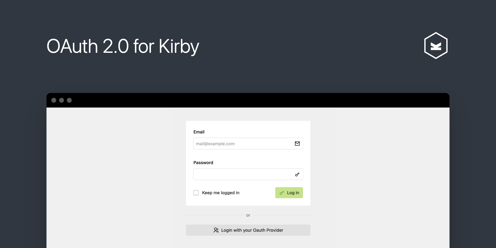

# Kirby OAuth 2.0 Plugin



This plugin is an plugin to provide [OAuth 2.0](http://oauth.net/2/) support for panel authentication in [Kirby](https://getkirby.com). It uses the [PHP League’s OAuth 2 Client](https://oauth2-client.thephpleague.com/), so all [official](https://oauth2-client.thephpleague.com/providers/league/) and [third-party providers](https://oauth2-client.thephpleague.com/providers/thirdparty/) are supported. It’s even possible to [implement your own](https://oauth2-client.thephpleague.com/providers/implementing/).

## Kirby Compatibility

- For **Kirby 6 and up** use version 4.0.0 or higher
- For **Kirby 4 and 5** use version 3
- For **Kirby 3.6 - 3.9** use version 2 or higher
- For **Kirby 3.0 - 3.6** use version 1 (not maintained anymore)

---

## Installation with Composer

Because of secondary dependencies for providers, **installation via composer is the only currently supported method**.

### Install the Plugin

```sh
composer require thathoff/kirby-oauth
```

### Install a Provider

The Plugin uses [PHP League’s OAuth 2 Client](https://oauth2-client.thephpleague.com/) so you can select from all [official](https://oauth2-client.thephpleague.com/providers/league/) and [third-party providers](https://oauth2-client.thephpleague.com/providers/thirdparty/). It’s also possible to use your own provider by using the `GenericProvider` or [implement your own](https://oauth2-client.thephpleague.com/providers/implementing/) provider.

For example to install support for Google run:

```sh
composer require league/oauth2-google
```

## Enable the Login Method

Since Kirby 6 the plugin registers a regular [auth method](https://getkirby.com/releases/6/migration/plugin-developers/auth) named `oauth`. Enable it with Kirby’s `auth.methods` option in your `config.php`:

```php
return [
  'auth' => [
    // OAuth in addition to the standard password login
    'methods' => ['password', 'oauth'],

    // or: only allow OAuth logins
    // 'methods' => ['oauth'],
  ],
];
```

Kirby shows a switcher on the login screen when more than one method is enabled. The OAuth callback route (see “Redirect URL” below) refuses all logins when the `oauth` method is not enabled.

### Two-Factor Authentication

OAuth logins respect Kirby’s second factors in the same way as the password method: users who have set up a second factor (e.g. TOTP or a passkey) must confirm it after the OAuth login. To require a second factor for every OAuth login, enable the `2fa` option of the method:

```php
'auth' => [
  'methods' => ['oauth' => ['2fa' => true]],
],
```

To skip Kirby’s second factor for OAuth logins completely, even for users who have set one up, set the option to `false`. Use this if your OAuth provider already enforces a second factor (e.g. Google Workspace or Microsoft Entra ID) or if your hooks need the full OAuth user (see “Use Hooks” below). The password method is not affected by this option.

```php
'auth' => [
  'methods' => ['oauth' => ['2fa' => false]],
],
```

### Single Provider and Automatic Redirect

If only one provider is configured, the `oauth` method is shown as “Login with &lt;provider name&gt;” with the provider’s icon in the login method switcher (instead of the `label` and `icon` options).

The login screen redirects to the provider without showing the OAuth login button when:

- the `oauth` method is selected in the login method switcher (e.g. switching from the password form to “Login with Google”), regardless of the `autoRedirect` option, or
- `autoRedirect` is enabled and `oauth` is the only enabled login method. In this case, the redirect also happens on every visit of the login screen, including after a logout.

There is no automatic redirect

- when more than one provider is configured,
- when the OAuth login failed (the error is shown on the login screen instead) or
- when the login screen is opened directly, after a logout or after the session expired while other login methods are enabled, so that these methods stay reachable.

## Options

### General Options

The following configuration options are available. And can be added to the Kirby `config.php`.

```php
return [
  'thathoff.oauth' => [
    // Add your providers configuration here
    'providers' => [
      // for details see „Provider Options” below
    ],

    // Only allow logins for existing kirby users (don’t create new users)
    'onlyExistingUsers' => false,

    // Set the default role of newly created users. The role has to exist in `site/blueprints/users`.
    'defaultRole' => 'editor',

    // Allow every valid user of all OAuth providers to login.
    // For details see “Configure Allowed Users” below.
    // DANGEROUS: Make sure you know what you’re doing when setting this to true!
    'allowEveryone' => false,

    // List of E-mail domains which are allowed to login
    'domainAllowlist' => [
      // For details see “Configure Allowed Users” below.
    ],

    // List of E-mail addresses which are allowed to login
    'emailAllowlist' => [
      // For details see “Configure Allowed Users” below.
    ],

    // List of E-mail addresses which will get the admin role assigned
    'adminAllowlist' => [
      // For details see “Configure Allowed Users” below.
    ],

    // Automatically redirect to the provider when the login screen is opened. This only works if
    // `oauth` is the only enabled login method (`'auth' => ['methods' => ['oauth']]`) and only one
    // provider is configured. For details see “Single Provider and Automatic Redirect” below.
    'autoRedirect' => false,

    // Allow creating the first user (installation) via OAuth even if Kirby’s installer is disabled
    // (`panel.install`), e.g. for fresh review apps on a public server without any users.
    // DANGEROUS: Every user allowed to log in can become the admin of a fresh installation!
    'allowInstallation' => false,

    // Set this to 'true' to disable checking for the 'email_verified' field in the OAuth response. While some providers do not send this information, it is recommended that you keep this option enabled if your provider supports it.
    'skipEmailVerifiedCheck' => false,

    // Label of the `oauth` method in the login method switcher (default: “OAuth”).
    // Either a string or an array of translations, e.g. ['en' => 'Single Sign-On', 'de' => 'Single Sign-On']
    // If only one provider is configured, “Login with <provider name>” is used instead.
    'label' => null,

    // Icon of the `oauth` method in the login method switcher (default: 'users').
    // Pick any default Kirby icon.
    // If only one provider is configured, the provider’s icon is used instead (if set).
    'icon' => null
  ],
];
```

> [!IMPORTANT]
> **Upgrading from version 3 (Kirby 4/5):**
>
> - The plugin no longer replaces the Panel login screen. Enable the `oauth` login method via `auth.methods` instead (see “Enable the Login Method” above).
> - The `onlyOauth` option has been removed. Use `'auth' => ['methods' => ['oauth']]` instead.
> - OAuth logins now trigger Kirby’s second factor if the user has set one up. Set `'2fa' => false` for the `oauth` method to keep the previous behaviour.
> - **On a public server the first user can only be created via OAuth if Kirby’s `panel.install` option or the new `allowInstallation` option is enabled.**
> - The API endpoints `oauth/settings` and `oauth/oauthError` have been removed.
> - **The options `domainWhitelist`, `emailWhitelist` and `adminWhitelist` have been renamed to `domainAllowlist`, `emailAllowlist` and `adminAllowlist`.** The old option names are no longer read, so rename them in your `config.php`.
> - **The default role for newly created users changed from `admin` to `editor`.** Make sure an `editor` role exists in `site/blueprints/users`, or set `'defaultRole' => 'admin'` explicitly to keep the old behaviour. Use the `adminAllowlist` to grant individual users admin access.

> [!IMPORTANT]
> **Breaking change for Azure Active Directory users:** Previous versions automatically mapped the `upn` claim to the email and treated it as verified. This implicit behaviour has been removed for security reasons (a malicious or misconfigured provider could otherwise claim arbitrary identities via `upn`). If you use Azure AD, you now have to configure this explicitly per provider:
>
> ```php
> 'emailField'    => 'upn',
> 'emailVerified' => true,
> ```
>
> See the `emailField` / `emailVerified` options in the provider configuration below.

### Provider Options

The `thathoff.oauth.providers` array is a list of all configured OAuth Providers with a unique key for each entry. Each array entry is used as the configuration option to a new OAuth Provider Class instance so all options which are documented for the selected OAuth Provider class are available.

For example adding `'hostedDomain' => 'example.com'` in your google provider options will restrict users to an `@example.com` google account, as documented [here](https://github.com/thephpleague/oauth2-google).

Additionally the two properties `name` and `class` are supported to supply a display name for the login screen and the Provider class to use when you don’t want to use the `GenericProvider`.

```php
//...
'providers' => [
  'google' => [
    'class' => "League\OAuth2\Client\Provider\Google",  // Use special google class from league/oauth2-google
    'clientId' => 'somerandomstring.apps.googleusercontent.com',
    'clientSecret' => 'clientsecret',
    'hostedDomain' => 'example.com'  // Restrict users to an `@example.com` google account (optional)
    'icon'         => 'users'  // Pick any default Kirby icon for the login button (optional)
    'theme'        => 'green'  // Pick any  Kirby theme colors (see https://lab.getkirby.com/public/lab/components/buttons/2_themes)
  ],
  'custom' => [
    // this one uses \League\OAuth2\Client\Provider\GenericProvider automatically
    'name'                    => 'My Custom Provider' // The name is optional
    'clientId'                => 'demoapp',    // The client ID assigned to you by the provider
    'clientSecret'            => 'demopass',   // The client password assigned to you by the provider
    'redirectUri'             => 'https://kirby.example.com/your-redirect-url/',
    'urlAuthorize'            => 'https://example.com/oauth2/lockdin/authorize',
    'urlAccessToken'          => 'https://example.com/oauth2/lockdin/token',
    'urlResourceOwnerDetails' => 'https://example.com/oauth2/lockdin/resource',
    'icon'                    => 'users',  // Pick any default Kirby icon for the login button (optional)
    'theme'                   => 'green'  // Pick any  Kirby theme colors (see https://lab.getkirby.com/public/lab/components/buttons/2_themes)
    'scope'                   => 'openid email profile',  //specify the scope passed form the OIDC provider to kirby
    'emailField'              => 'email',  // Field in the provider's user data that contains the email address (default: "email"). Use "upn" for Azure AD.
    'emailVerified'           => null,  // Override the email_verified claim: true treats the provider as always verifying emails, false as never. null (default) trusts the email_verified claim from the provider.
  ],
```

### Redirect URL

OAuth providers require you to supply a **redirect URL** of your kirby instance when configuring an application.
Please use `https://kirby.example.com/oauth/login/PROVIDER_ID` where kirby.example.com is your domain and PROVIDER_ID is the key
of the config option in config.php (in the previous config example `google` or `custom`). If you have
installed Kirby in a subdirectory, remember to include the subdirectory in the URL.

### Configure Allowed Users

By default only allowlisted users are allowed to login into the Kirby panel.

**Domain Allowlist:** By adding domains to the domain allowlist (`domainAllowlist`) all accounts with a verified email address at one of the domains are permitted.

**Email Allowlist:** By adding email addresses to the email allowlist (`emailAllowlist`) all accounts with a verified email address matching one of the entires are permitted.

**Admin Allowlist:** By adding email addresses to the admin allowlist (`adminAllowlist`) all accounts with a verified email address matching one of the entires are getting the admin role assigned.

**Allow Everyone:** By setting `allowEveryone` to `true` all authenticated accounts are able to login. *Please use this option with care!* Make sure the default role (`defaultRole`, default `editor`) does not grant more permissions than intended.

**Default Role:** Newly created users get the role defined with `defaultRole` when they first login. The default is `editor`, so make sure an `editor` role exists in `site/blueprints/users` or set `defaultRole` to an existing role. Users on the `adminAllowlist` get the `admin` role instead. The very first user (created during the installation) always becomes an admin. Just like Kirby’s own installer, this is only possible locally or when `panel.install` is enabled, unless you set `allowInstallation` to `true`. Please note that when the user has ben created already the role will not be updated. You can set this role to `nobody` if you want to manually allow users by changing the role in the Kirby panel.

**Only Existing User:** By setting `onlyExistingUsers` to true only created uses are able to login with an OAuth provider, no new users are created.

### Use Hooks

Before and after the KirbyUser gets created or logged in a hook is triggered.

```php
/**
 * @var \League\OAuth2\Client\Provider\ResourceOwnerInterface $oauthUser
 * @var Kirby\Cms\User $user
 */

'hooks' => [
    'thathoff.oauth.user-create:before' => function ($oauthUser) {
      // return null|true to use the plugins user-creation
      // return a Kirby\Cms\User to overwrite the plugin user creation
    },
    'thathoff.oauth.user-create:after' => function ($oauthUser, $user) {

    },
    'thathoff.oauth.login:before' => function ($oauthUser, $user) {

    },
    'thathoff.oauth.login:after' => function ($oauthUser, $user) {

    }
]
```
